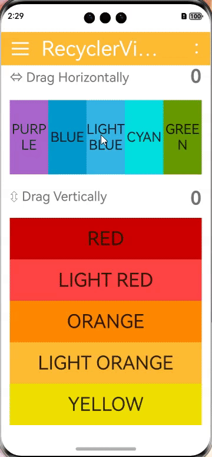

<div align="center">
<h1>overScrollDecor4cj </h1>
</div>

<p align="center">


</p>

## 介绍
类似iOS风格的边缘滚动效果视图。 支持下列视图：RecyclerView, ListView, GridView, ViewPager, ScrollView, HorizontalScrollView, Any View - Text, Image...
<p align="left">

</p>

## 特性
- 支持下列滚动容器视图：RecyclerView, ListView, GridView, ViewPager, ScrollView, HorizontalScrollView, Any View - Text, Image...

### 源码目录
```shell
.
├── AppScope
├── doc    # API文档和使用手册存放目录
│   ├── assets
│   ├── feature_api.md
├── entry  # 示例代码文件夹 
├── hvigor  # 构建工具目录
├── overscrolldecor    # overscroll库文件夹
├── CHANGELOG.md
├── LICENSE
├── NOTICE
├── README.md  # 介绍及使用说明 
```

## 接口说明
主要是核心类和函数接口说明见 [API](doc/feature_api.md)<!--待更新-->

## 使用说明
1. 通过 module 引入
    1. 克隆下载项目
    2. 将 overScrollDecor4cj 模块拷贝到应用项目下
    3. 修改自身应用 entry/src/main/cangjie 下的 cjpm.toml 文件，在 [dependencies] 字段下添加 dependencies.overscrolldecor ,再添加path = "../../../../overscrolldecor/src/main/cangjie"
       ```toml
       [dependencies]
          [dependencies.overscrolldecor]
             path = "../../../../overscrolldecor/src/main/cangjie"
       ```
    4. 在项目中使用 import overscrolldecor.* 引用 overScrollDecor4cj
       ```cangjie
       import overscrolldecor.*
       ```
2. 把 overScrollDecor4cj 作为三方库依赖引入
    1. 目标工程把 overScrollDecor4cj 依赖库作为 git submodule 引入

    ```
    > cd $工程根目录
    > mkdir third-party
    > cd third-party
    > git submodule add "https://gitcode.com/Cangjie-TPC/overScrollDecor4cj.git"
    ```
    2. 修改自身应用 entry/src/main/cangjie 下的 cjpm.toml 文件，添加依赖
    ```toml
   [dependencies]
      [dependencies.overscrolldecor]
         path = "../../../../overscrolldecor/src/main/cangjie"    
   ```
    3. 在项目中使用 overScrollDecor4cj 组件
       ```cangjie
       import overscrolldecor.*
       ```

## 功能示例
详见 [entry](entry/src/main/cangjie/src/index.cj)

```cangjie
    // 实例化OverScrollDecor.Model 对象 
    @State
    var horizontalView: OverScrollDecorModel = OverScrollDecorModel()
    @State
    var verticalView: OverScrollDecorModel = OverScrollDecorModel()
    // 展示的颜色
    private var color: Array<UInt32> = [0Xffaa66cc, 0Xff0099cc, 0Xff33b5e5, 0X00e0e0, 0Xff669900, 0Xff99cc00, 0Xf0e000,
        0Xffffbb33, 0Xffff8800, 0Xffff4444, 0Xffcc0000]
    private var colorName: Array<String> = ["PURPLE", "BLUE", "LIGHT BLUE", "CYAN", "GREEN", "LIGHT GREEN", "YELLOW",
        "LIGHT ORANGE", "ORANGE", "LIGHT RED", "RED"]  

    // 通过Model类对象设置UI属性来自定义所需风格
    protected override func aboutToAppear(): Unit {
        this.horizontalView.setUpOverScroll(true).setOrientation(ORIENTATION.HORIZONTAL).setOverScrollBounceEffect(
            this.overScrollBounceEffect).setScrollBar(false).setWidth(100.percent).setHeight(24.percent)

        this.verticalView.setUpOverScroll(true).setOrientation(ORIENTATION.VERTICAL).setOverScrollBounceEffect(
            this.overScrollBounceEffect).setScrollBar(false).setWidth(100.percent).setHeight(54.percent)
    }

    // 组件绘制
    @Builder
    func recyclerViewVertical() {
        Flex(FlexParams(direction: FlexDirection.Column, alignItems: ItemAlign.Center)) {
            ForEach(
                this.colorName,
                itemGeneratorFunc: {
                    item: String, index: Int64 => Text(this.colorName[this.colorName.size - 1 - index]).width(
                        100.percent).height(20.percent).fontSize(35).textAlign(TextAlign.Center).backgroundColor(
                        this.color[this.colorName.size - 1 - index]).onClick(
                        {
                        evt => PromptAction.showToast(
                            message: "Tapped on: " + this.colorName[this.colorName.size - 1 - index],
                            duration: 2000
                        )
                    })
                }
            )
        }
    }

    @Builder
    func RecyclerViewHorizontal() {
        Flex(FlexParams(direction: FlexDirection.Row, alignItems: ItemAlign.Center, justifyContent: FlexAlign.Center)) {
            ForEach(
                this.colorName,
                itemGeneratorFunc: {
                    item: String, index: Int64 =>
                        Text(item).width(20.percent).height(90.percent).fontSize(25).textAlign(
                        TextAlign.Center).backgroundColor(this.color[index]).onClick(
                        {
                        evt => PromptAction.showToast(message: "Tapped on: " + item, duration: 2000)
                    })
                }
            )
        }
    }
    
    // 界面绘制：
    build() {
     Stack(Alignment.TopStart) {      
     ......
     OverScrollDecor(model: this.horizontalView, child: this.RecyclerViewHorizontal)
     OverScrollDecor(model: this.verticalView, child: this.recyclerViewVertical)   
     ......
     }
    }
```

## 约束与限制
在下述版本验证通过：

    DevEco Studio NEXT Developer Beta2(5.0.3.910) 
    Cangjie Support Plugin 5.0.3.906 

## 开源协议
本项目基于 [Apache License 2.0](./LICENSE) ，请自由地享受和参与开源。

## 参与贡献
欢迎给我们提交PR，欢迎给我们提交Issue，欢迎参与任何形式的贡献。

